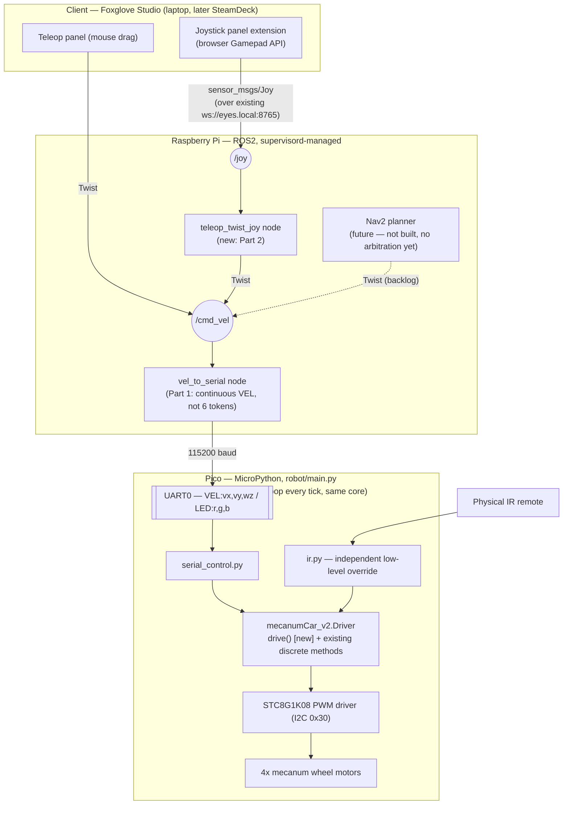

# Plan: motor mixer + joystick control

## Context

`docs/notes/plan.md` names the immediate next step: replace `vel_to_serial`'s 6 fixed-speed
direction commands with continuous velocity control (a mecanum mixer on the Pico side). The
user wants to widen that into a short architecture pass: confirm how Pi and Pico talk, confirm
IR's role, and — since the goal is to drive the robot manually before attempting autonomous
navigation — add real joystick control on top, following the pattern set by Foxglove's existing
Teleop panel (mouse-drag widget → `cmd_vel` → `vel_to_serial` → Pico, documented in
`docs/remote_control.md`). SteamDeck-as-controller is a stated future want, not work for now.

Existing pieces, confirmed by reading the code (not just docs):
- `robot/main.py` on the Pico already runs `ir_loop()` and `serial_loop()` every cycle,
  unconditionally, in the same loop — IR is *already* the independent low-level override the
  user remembered it as. No change needed there.
- `ros-jazzy-joy` and `ros-jazzy-teleop-twist-joy` are already installed on the Pi (`dpkg -l`
  confirmed) — no new apt packages required.
- `teleop_twist_joy` ships a holonomic example config
  (`/opt/ros/jazzy/share/teleop_twist_joy/config/ps3-holonomic.config.yaml`) mapping
  `axis_linear.x/y` + `axis_angular.yaw` — the right shape for a mecanum robot, unlike the
  default (non-strafing) `xbox.config.yaml`.
- Neither `vel_to_serial` nor the new joystick node are in `supervisord.conf` today
  (`docs/supervisord.md` currently notes the Pico link is "still run by hand") — this plan
  registers both, see "Supervisord registration" under Part 1/Part 2 below.

Decisions already made with the user:
- Joystick connects to whatever runs Foxglove Studio (laptop or, later, SteamDeck) via a
  Foxglove joystick-panel extension publishing `sensor_msgs/Joy` over the existing
  `ws://eyes.local:8765` link — not a gamepad plugged into the Pi. This is what makes the
  SteamDeck backlog item free later (same mechanism, different client).
- No `cmd_vel` arbitration (`twist_mux`) yet — only one control source is used at a time by
  convention today, and it isn't worth building until Nav2 exists to actually need it.

## Architecture (target state, after this plan)



Key point the diagram makes explicit: IR and UART are two independent inputs into the same
`Driver`, both serviced every iteration of the same cooperative loop on the Pico — that's
already true today (`robot/main.py`), nothing to change there. Everything above `vel_to_serial`
(mouse panel, joystick, future Nav2) converges on one `cmd_vel` topic with no arbitration —
acceptable per the decision above, revisit when Nav2 lands.

## Part 1 — Continuous-velocity mixer (Pi ↔ Pico)

Protocol change, documented in `docs/motor-control.md`:
```
VEL:vx,vy,wz      # replaces FWD/BACK/LEFT/RIGHT/STRAFE_L/STRAFE_R/DIAG_*/DRIFT_*, each in [-1, 1]
LED:r,g,b         # unchanged
```
`STOP` collapses into `VEL:0,0,0` — no separate token needed.

**`robot/mecanumCar_v2.py`** — add a `drive(vx, vy, wz)` method to `Driver`, alongside (not
replacing) the existing discrete methods `Advance`/`Back`/`Turn_Left`/`Turn_Right`/etc., which
`robot/ir.py` calls directly and must keep working unchanged. Standard mecanum mix:
```
fl = vx - vy - wz
fr = vx + vy + wz
bl = vx + vy - wz
br = vx - vy + wz
```
Normalize by the largest magnitude among the four so nothing clips, scale to a PWM value (start
at the old cruising magnitude — `SPEED = 60` — as the ceiling, since that was already a proven
safe speed; retune from there by feel), derive each wheel's direction bit + magnitude, and call
the existing `Motor_Upper_L`/`Motor_Lower_L`/`Motor_Upper_R`/`Motor_Lower_R`.

**`robot/serial_control.py`** — parse a `VEL:` line into three floats and call
`mecanumCar.drive(vx, vy, wz)` instead of dict-dispatching a fixed token. Keep the `LED:`
handling and the existing 1s-silence → `stop()` timeout as-is.

**`ros2_ws/src/pico_control/pico_control/vel_to_serial.py`** — replace `_to_command`'s
nearest-direction matching with direct normalization: divide `linear.x`/`linear.y`/`angular.z`
by configurable max-speed ROS params (new `declare_parameter`s, e.g. `max_linear_speed`,
`max_angular_speed`) and clamp to `[-1, 1]`. Since floats will rarely be bit-identical, switch
from the current dedup-on-exact-match send (`if command == self.last_command: return`) to a
timer-driven send (e.g. 20 Hz, via `create_timer`) of the latest stored values — keep the
existing 0.5s-silence → stop safety timer unchanged, just have it send `VEL:0,0,0` instead of
the string `"STOP"`.

**`docs/motor-control.md`** — update the protocol table and the "what's not wired up yet"
section (the "Speed is a fixed constant" bullet goes away).

**Supervisord registration** — add to `ros2_ws/supervisord.conf`, following the existing
pattern (e.g. `[program:depthai]`):
```ini
[program:pico_control]
command=python launch_pico_control.py
killasgroup=true
stopasgroup=true
```
Update `docs/supervisord.md`'s program table (drop the "not currently in this list — still run
by hand" note for the Pico link) and the "What's not wired up yet" bullet in
`docs/motor-control.md` that says the same thing.

## Part 2 — Joystick control

**Client side (no repo changes):** install the Foxglove joystick-panel extension in Foxglove
Studio; it reads the browser Gamepad API and publishes `sensor_msgs/Joy` on `/joy` over the
already-open `ws://eyes.local:8765` connection — same link already used for viewing and the
mouse Teleop panel, no new network path to set up.

**Robot side — new `teleop_twist_joy` launch:** add `ros2_ws/launch_teleop_joy.py`
(same style as the existing `launch_pico_control.py`) that runs
`teleop_twist_joy`'s `teleop_node`, subscribing to `/joy` and publishing `cmd_vel` — the same
topic `vel_to_serial` already consumes, so no changes needed there beyond Part 1. Add a params
file under `ros2_ws/config/` (new dir doesn't exist yet — check `ros2_ws/config/` for
`diagnostics_aggregation.yaml` as the existing sibling) based on
`ps3-holonomic.config.yaml`'s shape (`axis_linear.x/y`, `axis_angular.yaw`, `scale_linear`,
`scale_angular`, `enable_button`) — axis/button indices will need empirical tuning against
whatever the Foxglove extension actually emits; that tuning happens live against
`ros2 topic echo /joy`, not guessed in code.

**`docs/remote_control.md`** — document the joystick path under "Manual driving today"
alongside the existing Teleop-panel description, and add a backlog note: SteamDeck as a
joystick client needs no new engineering once this works — same extension, same mechanism,
just a different device running Foxglove Studio with its controller exposed as a standard
browser gamepad via Steam Input.

**Supervisord registration** — add alongside the Part 1 entry:
```ini
[program:teleop_joy]
command=python launch_teleop_joy.py
killasgroup=true
stopasgroup=true
```
Same doc updates as above (`docs/supervisord.md` program table).

## Explicitly not doing now

- No `cmd_vel` arbitration/mux — backlog, revisit once Nav2 exists.
- No Nav2/path-planning work — already scoped as its own future task in
  `docs/remote_control.md`, untouched by this plan.

## Verification

1. **Mixer:** `cd robot && make flash` to push the updated Pico files, reset. Before touching
   supervisord, hand-launch `vel_to_serial` (`cd ros2_ws && python launch_pico_control.py`) to
   iterate quickly, drive via the existing Foxglove Teleop panel, confirm smooth blended
   strafe/rotate/forward motion (not the old 6-direction snapping) and that releasing the panel
   still triggers stop within ~0.5–1s. Once confirmed working, register it in
   `supervisord.conf` and verify via `supervisorctl -c ros2_ws/supervisord.conf status` /
   `restart pico_control`.
2. **Joystick:** connect a gamepad to the Foxglove client, install the joystick panel
   extension, hand-launch `teleop_twist_joy` (`ros2 run teleop_twist_joy teleop_node --ros-args
   --params-file ros2_ws/config/teleop_joy.yaml`) first, `ros2 topic echo /joy` then
   `ros2 topic echo /cmd_vel` to confirm axis mapping before trusting it to drive the physical
   robot. Once the mapping is right, register it in `supervisord.conf` the same way.
