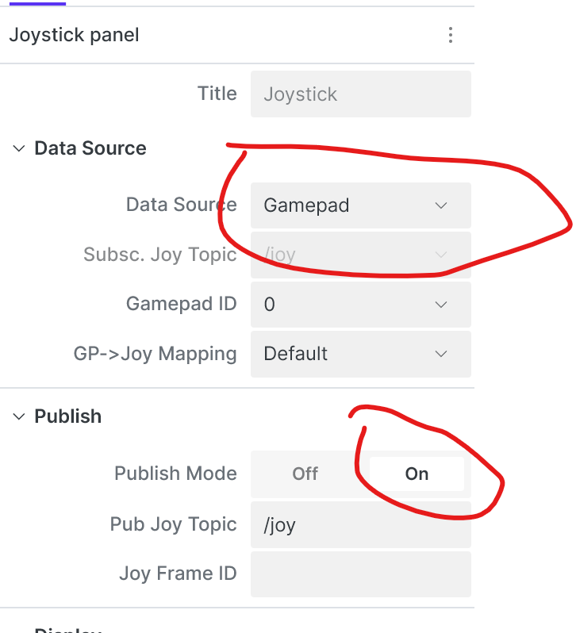

# Remote control & visualization

How to see what the robot sees, and how to actually drive it, from a laptop rather than
standing over the Pi.

## History

Three approaches have been tried, in order:

1. **VNC + RViz/rqt on the Pi itself.** Remote desktop into the Pi and run the normal ROS GUI
   tools locally on it ([infra/install-ubuntu.sh](../_archive/install-ubuntu.sh) in the
   archive installed the VNC server + desktop packages for this). Works, but the Pi is
   rendering RViz for you as well as running the whole perception stack — heavy, and the
   least practical option once the graphics load and the SLAM load compete for the same
   weak GPU/CPU.
2. **Full ROS 2 on the desktop, joined to the same network.** Run RViz/`rtabmap_viz` directly
   on a laptop as a normal ROS 2 node, discovering the Pi's nodes over DDS. Tried on WSL (broke
   networking) and a dual-boot Ubuntu install (better, but unstable — RTAB-Map's odometry
   quality would periodically collapse to 0 and need a restart). The likely root cause,
   per [docs/notes/2025.04.19.md](notes/2025.04.19.md): raw image topics over Wi-Fi don't hold
   up — full-resolution frames just don't transfer reliably, and DDS discovery over a flaky
   link isn't much better.
3. **`foxglove_bridge`.** What's actually running today ([docs/supervisord.md](supervisord.md)
   lists it as a supervised program on port 8765). This sidesteps both problems above:
   rendering happens on the client, not the Pi, and — unlike raw DDS — you only pay for the
   topics you actually subscribe to in a given Foxglove layout, instead of every image topic
   flowing whether you're looking at it or not. The recorded failure mode is the opposite
   extreme: subscribing to a full-resolution image topic saturates the websocket
   (`Send buffer limit reached`, seen in `ros2_ws/log/`) — so the fix is being selective about
   what a layout subscribes to, not switching approach again.

**Current answer: use Foxglove Studio, connect to `ws://eyes.local:8765`.** It's the right
tool for both monitoring and — see below — basic driving.

## Manual driving today

Foxglove's **Teleop panel** publishes `geometry_msgs/Twist` directly to `cmd_vel`, which
[vel_to_serial](motor-control.md) already consumes and turns into wheel commands. This works
right now with no additional stack — it's the cheapest option and good enough for
driving-around testing.

**Joystick** is the same pipeline with a different `/cmd_vel` producer: install Foxglove
Studio's joystick-panel extension, which reads the browser Gamepad API and publishes
`sensor_msgs/Joy` on `/joy` over the same already-open `ws://eyes.local:8765` connection — no
gamepad plugged into the Pi itself, no new network path. On the robot side,
`ros2_ws/launch_teleop_joy.py` runs `teleop_twist_joy`'s `teleop_node`, subscribing to `/joy`
and publishing `cmd_vel` — the same topic the Teleop panel already feeds, so `vel_to_serial`
needs no changes:

```bash
cd ros2_ws && python launch_teleop_joy.py
```



Axis indices in `ros2_ws/config/teleop_joy.yaml` are confirmed by testing, not guessed: a live
`/joy` message showed 4 axes + 17 buttons, all near-zero at rest, matching the
[W3C Standard Gamepad Mapping](https://w3c.github.io/gamepad/#remapping)'s axis/button count,
so the Foxglove extension is relaying the browser Gamepad API's axes/buttons directly — axis
0/1 = left stick X/Y, axis 2 = right stick X. The scale *signs*, though, turned out to be the
opposite of that spec's textbook stick-up/stick-left-reads-`-1` convention — confirmed by
actually driving it, not derived from the spec, so if this extension or a future one behaves
differently, re-check by testing rather than assuming the spec's convention holds.
`enable_button`/`enable_turbo_button` (6/7 — right bumper/trigger area, per the standard
mapping) were tuned the same way: comfort holding it while driving is a judgment call, not
something a spec fixes. Registered in `supervisord.conf` as `teleop_joy` — starts with the
rest of the stack, see [docs/supervisord.md](supervisord.md).

Backlog: SteamDeck as the joystick client needs no new engineering once this works — same
extension, same mechanism, just Foxglove Studio running on the SteamDeck instead of a laptop,
with its controller exposed as a standard browser gamepad via Steam Input.

## Giving it plans (not yet wired up)

"Drive to this point on the map" needs more than a viewer: something has to turn RTAB-Map's
map into a costmap, and something has to plan a path through it and drive the result. Nothing
in this repo does that today — RTAB-Map produces odometry and a map/graph, but nothing
consumes it as a navigation goal.

The standard piece for this is **Nav2** (`nav2_bringup`, a costmap fed from RTAB-Map's
occupancy grid output, plus planner and controller servers). Once that's running, Foxglove's
map panel can click-to-send a goal pose exactly like RViz's "2D Nav Goal" — no new
remote-control mechanism needed, just a consumer for the goal topic on the robot side.

This is a real chunk of new work (costmap tuning, planner/controller parameters, recovery
behaviors), not a config tweak — treat it as its own task rather than folding it into
motor-control or depthai changes.
